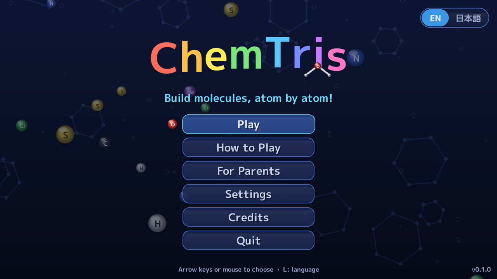
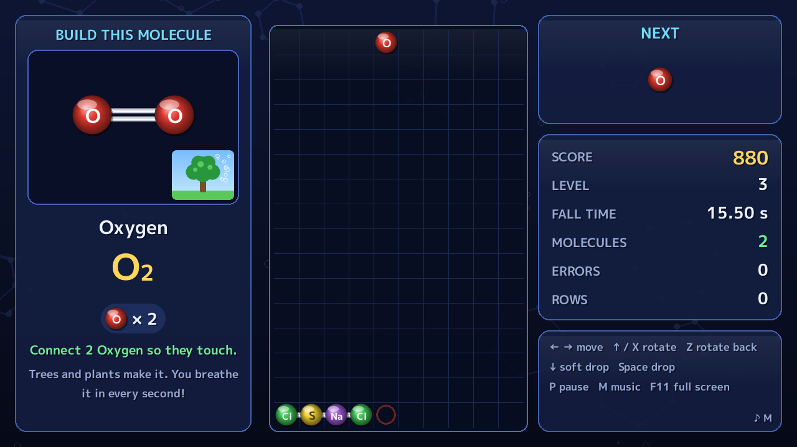
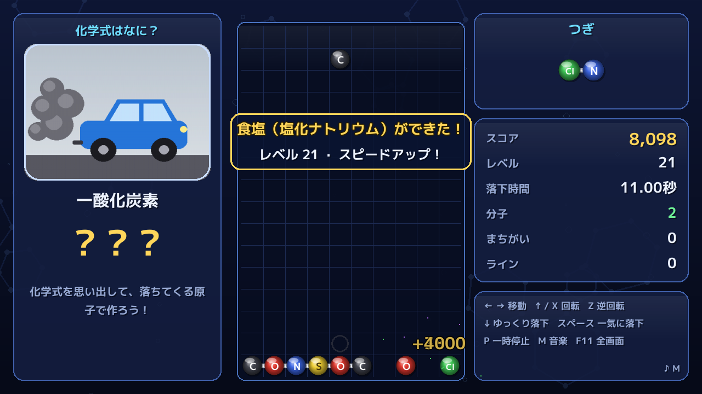
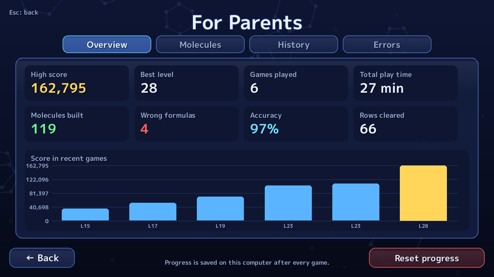

# ChemTris ケムトリス

**Build molecules, atom by atom!** ChemTris is a falling-block puzzle game where
the blocks are atoms. The card on the left shows a molecule. Stack the falling
atoms so the right ones touch, and you build it. Then the next molecule appears.

English and Japanese (日本語) · Endless levels · Windows and Linux · Free (GPL v3)



## How to play

| | |
|---|---|
|  |  |

1. Atoms (**H**, **O**, **C**, **N**, **Na**, **Cl**, **S**) fall from the top in
   small pieces. The **NEXT** box in the top right shows what's coming.
2. Put atoms next to each other (left, right, above or below) so they form the
   molecule on the card. For water, that's two **H** and one **O**: **H₂O**.
3. **Exactly right:** the molecule bursts, blasts away nearby rubble, and the
   next level starts with a new molecule straight away. You never have to press
   Enter.
4. **Wrong formula:** if a group has every element of the target but the
   wrong number of atoms (H₃O or H₂O₂ when you need H₂O, for example), it turns
   into grey rubble and counts as an error.
5. **Fill a whole row** to clear it, like in classic falling-block games.
6. **Game over** when any block reaches the top row of the field.

### The cards get harder

| Levels | What the card shows |
|---|---|
| 1 – 17 | Ball-and-stick diagram, name, formula, the atoms needed ("Connect 2 Hydrogen and 1 Oxygen so they touch"), a fun fact, and a small picture. Each of the 17 molecules gets introduced in turn. |
| 18 – 29 | A picture and the name only. You have to remember the formula. |
| 30 and up | **Only a picture**, like a glass of water. No other hints! |

### It gets faster

A piece takes **16 seconds** to fall the whole field on level 1. Every level
takes off 0.25 s, so every 5 levels the drop is **1.25 seconds faster**. The
speed stops increasing at 1 second per field (around level 61), and levels go on
forever.

### The molecules

| Formula | Name | Picture | | Formula | Name | Picture |
|---|---|---|---|---|---|---|
| H₂O | Water | Glass of water | | NH₃ | Ammonia | Spray cleaner |
| H₂ | Hydrogen gas | Rocket | | H₂S | Hydrogen sulfide | Rotten egg |
| O₂ | Oxygen | Tree | | N₂O | Laughing gas | Laughing face |
| NaCl | Table salt | Salt shaker | | NaOH | Sodium hydroxide | Soap |
| HCl | Hydrochloric acid | Stomach | | CH₄ | Methane | Gas flame |
| CO₂ | Carbon dioxide | Soda bottle | | H₂O₂ | Hydrogen peroxide | First-aid bottle |
| CO | Carbon monoxide | Car exhaust | | C₂H₄ | Ethylene | Ripening banana |
| N₂ | Nitrogen | Frosty flask | | | | |
| Cl₂ | Chlorine | Swimming pool | | | | |
| O₃ | Ozone | Earth's shield | | | | |

### Controls

| Key | Action |
|---|---|
| ← → (or A D) | Move |
| ↑, X (or W) | Rotate clockwise |
| Z | Rotate back |
| ↓ (or S) | Soft drop |
| Space | Hard drop |
| P or Esc | Pause |
| M | Music on/off |
| F11 | Full screen |
| L | Switch language (title screen) |

Menus work with the arrow keys and Enter, or the mouse.

## Title screen

- **Play**: start at level 1.
- **How to Play**: the rules and the seven atoms.
- **For Parents**: the progress report (below).
- **Settings**: music, sound effects, full screen, language.
- **Credits**: authors, website, email, version and date.
- **EN | 日本語** toggle in the top right switches the whole game between
  English and Japanese. Press **L** to do the same.

## For Parents



Every game is saved automatically on the computer, so you can check how your
child is doing:

- **Overview**: high score, best level, games played, total play time, molecules
  built, wrong formulas, accuracy, rows cleared, and a chart of recent scores.
- **Molecules**: for each molecule, how often it was built, how many wrong
  attempts, accuracy and the fastest time.
- **History**: the last 50 games with date, score, level, molecules, errors and
  play time.
- **Errors**: the last 100 wrong formulas, showing the goal and what was made
  instead, such as *goal H₂O, made HO₂*. Useful for spotting which molecules
  need practice.
- **Reset progress** (click twice) erases the record.

Progress is stored in `%APPDATA%\ChemTris\` on Windows and
`~/.local/share/chemtris/` on Linux.

## Music

All music is classical and in the public domain, synthesised by the game
itself (no audio files):

- Title: Mozart, *Eine kleine Nachtmusik*
- Gameplay (changes every 5 levels, and speeds up as you go): Grieg, *In the
  Hall of the Mountain King*; Rossini, *William Tell Overture* (finale);
  Mozart, *Rondo alla Turca*
- Menus: Beethoven, *Für Elise*
- New level: Beethoven, *Ode to Joy*
- Game over: Chopin, *Funeral March*

## Install

Download from the releases:

- **Windows:** `ChemTris-v0.1.0.exe`. Run it. No install needed.
- **Debian / Ubuntu:** `chemtris_v0.1.0_amd64.deb`, then
  `sudo apt install ./chemtris_v0.1.0_amd64.deb` and start **ChemTris** from the
  menu or type `chemtris`.

## Play in the browser

ChemTris also runs in a web browser, on computers, phones and tablets, with nothing to
install: <https://shoukugames.org/play/chemtris/> (test page).

On touch screens, on-screen buttons replace the keyboard during play: move, soft drop,
hard drop, rotate both ways, pause and music. Settings and the progress record are saved
in the browser.

The web version is built with [pygbag](https://pygame-web.github.io/) from the same code;
`main.py` is its entry point, and the browser-only parts (main loop, music rendering,
saving, touch buttons) only switch on in the browser.

```bash
python3 -m pip install pygame pygbag
python3 tools/build_web.py       # -> build/web/ (index.html, chemtris.apk, ...): upload as-is
```

`chemtris.apk` is pygbag's name for its bundle of game files; it is not an Android app.

## Run from source

Needs Python 3.9+.

```bash
python3 -m venv .venv
.venv/bin/pip install -r requirements.txt
.venv/bin/python run_game.py            # add --windowed, --fullscreen or --level 30
```

## Build the binaries

On Debian/Ubuntu (amd64) with `python3-venv`, `dpkg-deb`, `wine` and `xvfb-run`:

```bash
./build.sh                       # both
packaging/build_linux.sh         # dist/chemtris_v<version>_amd64.deb
packaging/build_windows.sh       # dist/ChemTris-v<version>.exe (downloads Windows Python into build/ the first time)
```

Each build script runs the finished program in a smoke test (every screen in
both languages plus a robot playing) before it reports success.

## Development

```bash
.venv/bin/pip install -r requirements-dev.txt
.venv/bin/python -m pytest              # rules, content, both languages, saving
.venv/bin/python tools/screenshots.py   # every screen to build/screenshots/
.venv/bin/python tools/make_icon.py     # redraw assets/icon.png and icon.ico
```

| File | What's in it |
|---|---|
| `chemtris/game.py` | The rules: board, pieces, matching, scoring, speed (no drawing) |
| `chemtris/molecules.py` | Molecules: formulas, names, facts, diagram layout |
| `chemtris/play.py` | The game screen |
| `chemtris/scenes.py` | Title, How to Play, Settings, Credits, For Parents |
| `chemtris/art.py` | All graphics, drawn in code |
| `chemtris/audio.py` | Synthesiser, sound effects and the music |
| `chemtris/i18n.py` | English and Japanese text |
| `chemtris/storage.py` | Settings and progress files |
| `chemtris/autoplay.py` | Robot player for tests and the smoke test |

Found a bug? See [BUGREPORT.md](BUGREPORT.md).

## Credits

Created by **Shawn Rapaz** and **Claude Code**
Website: <https://shoukugames.org/> · Email: <info@shoukugames.org>
Version 0.1.0 · 2026-11-04

Font: M+ 1p by the M+ Fonts Project (SIL Open Font License, see
`assets/fonts/OFL.txt`). Game licensed under the GNU GPL v3 (see `LICENSE`).
